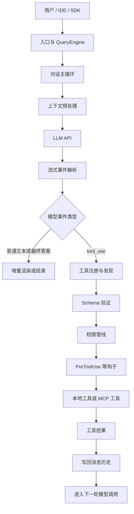
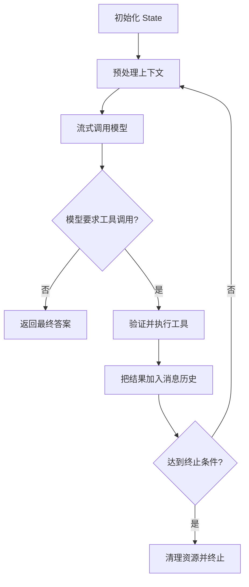
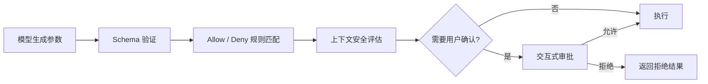
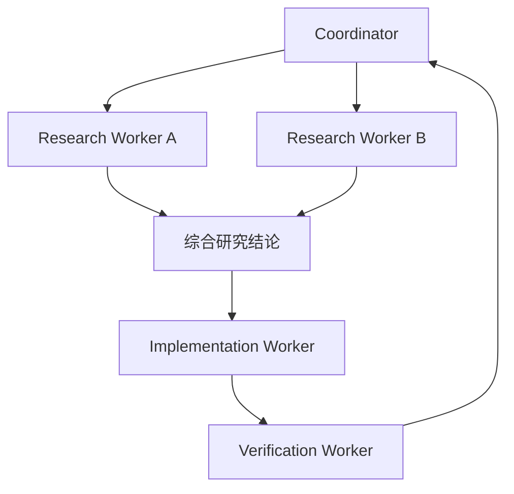

# 《御舆：解码 Agent Harness》详细学习笔记

> 来源：[lintsinghua.github.io](https://lintsinghua.github.io) 及其公开仓库 [lintsinghua/claude-code-book](https://github.com/lintsinghua/claude-code-book)。  
> 本笔记是对全书 15 章和 4 个附录的结构化转述，并补充跨章节理解，不是原文复制。

## 0. 阅读边界

这本书不是 Claude Code 使用手册，而是从公开文档、产品行为和社区资料出发，对 Claude Code 的 Agent Harness 架构进行分析和推演。因此要区分三类结论：

1. **通用架构模式**：对话循环、工具 Schema、权限管线、上下文预算等，可迁移到其他 Agent。
2. **Claude Code 的产品实现**：工具名称、配置层级、权限模式和内部模块可能随版本变化。
3. **作者的架构推演**：适合建立心智模型，但不能视为厂商对所有内部实现的正式承诺。

特别注意：书中的 Claude Code 自动压缩流程，不应直接等同于 Codex 或其他 Agent 的实现。不同客户端可能采用摘要、截断、开启新上下文窗口等不同策略。

---

## 1. 全书一句话总结

**LLM 只是推理引擎，Agent Harness 才是让它能够持续、安全、可观测地完成真实任务的运行时系统。**

普通聊天程序大致是：

```text
用户消息 -> 调用模型 -> 返回文本
```

Agent Harness 则是：

```text
用户任务
  -> 组织上下文
  -> 流式调用模型
  -> 检测工具调用
  -> 验证 Schema
  -> 检查权限
  -> 执行工具
  -> 回填工具结果
  -> 再次调用模型
  -> 压缩、恢复、终止或交付结果
```

---

## 2. Agent Harness 总体架构



> 为避免图在窄屏中横向溢出，主图只展示核心执行链。记忆、上下文压缩、子智能体和可观测性都是围绕对话主循环工作的旁路系统，见下表。

可以把各模块理解为：

| 模块 | 核心问题 |
|---|---|
| LLM | 下一步应该做什么？ |
| 对话循环 | 如何让“思考—行动—观察”持续运行？ |
| 工具系统 | Agent 能做哪些事？ |
| Schema | 模型生成的参数是否符合程序契约？ |
| 权限管线 | 即使参数合法，这件事是否允许做？ |
| 上下文管理 | 有限窗口里应该保留什么？ |
| 记忆系统 | 跨会话应该保存什么？ |
| Hook | 如何在生命周期节点插入自定义逻辑？ |
| MCP | 如何用统一协议连接外部能力？ |
| 子智能体 | 如何隔离并行任务并汇总结果？ |
| Harness | 如何把以上系统组织成可靠产品？ |

---

# 第一部分：基础篇

## 3. 第 1 章：智能体编程的新范式

### 3.1 从 Chatbot 到 Agent

Chatbot 的输出目标通常是文本；Agent 的输出目标是**环境状态发生符合用户意图的变化**。例如修改文件、运行测试、查询数据库或创建 Issue。

工具调用使 LLM 从“语言生成器”变为“决策引擎”：

```text
观察当前状态 -> 选择工具 -> 生成参数 -> 获取执行结果 -> 调整下一步
```

模型本身并不负责安全执行。它只产生具有不确定性的决策，因此需要 Harness 提供确定性的工程边界。

### 3.2 简单 API 封装为什么不够

一个生产级 Agent 至少要解决：

- 流式输出和增量事件解析；
- 工具定义、动态发现和调度；
- 参数验证、权限确认和工作区隔离；
- 消息历史、Token 预算和上下文压缩；
- 取消、超时、重试、错误恢复和断路器；
- 会话、计划、记忆和任务状态持久化；
- 插件、技能、Hook 和 MCP 扩展；
- 日志、成本、缓存和可观测性。

因此，Harness 不是“调用 LLM API 的工具库”，而是 Agent 的运行时环境。

### 3.3 五大设计原则

1. **异步流式优先**：所有长流程都尽量增量产生事件，并支持取消。
2. **安全边界内嵌**：安全不是外层补丁，而要进入工具、权限和执行的每个边界。
3. **缓存感知设计**：系统提示、工具列表和消息前缀的稳定性直接影响成本与延迟。
4. **渐进式能力扩展**：功能、工具、技能按需启用，不一次加载全部能力。
5. **不可变状态流转**：每次状态变化产生新状态，让转换可追踪、可测试。

---

## 4. 第 2 章：对话循环——Agent 的心跳

### 4.1 为什么使用异步生成器

典型消费方式：

```ts
for await (const event of runAgent()) {
  render(event);
}
```

异步生成器同时解决了：

- `yield`：模型产生一点，界面渲染一点；
- `yield*`：把子流程事件自然转发给上层；
- `return`：返回最终终止结果；
- `throw`：错误沿调用链传播；
- `AbortSignal`：中途取消模型或工具任务；
- 背压：消费者按自己的速度逐项处理事件。

相比之下，回调容易形成多层嵌套，普通 Promise 主要表达单次最终结果，事件发射器则需要额外处理监听器清理、完成语义和错误传播。

### 4.2 一个 Turn 的生命周期



进入下一轮模型调用后，模型可能：

- 再调用一个或多个工具；
- 根据工具结果修正计划；
- 请求用户补充信息；
- 返回最终答案；
- 因预算、取消或错误而终止。

### 4.3 状态转换模型

状态中通常包含：

```ts
type LoopState = {
  messages: Message[];
  turnCount: number;
  abortController: AbortController;
  transition?: string;
  usage?: TokenUsage;
};
```

每一轮创建新状态，不原地修改旧状态。这样可以记录：

```text
user_input
  -> model_stream
  -> tool_requested
  -> permission_granted
  -> tool_completed
  -> continue
  -> final_answer
```

### 4.4 依赖注入

模型调用、压缩、UUID、时间和文件 I/O 都属于外部副作用，应通过依赖注入传入。测试时可以替换为假实现，验证循环本身，而不真正访问网络或磁盘。

---

## 5. 第 3 章：工具系统——Agent 的双手

### 5.1 工具的五要素

一个完整工具通常需要：

1. `name`：稳定、唯一的名称；
2. `inputSchema`：参数格式和约束；
3. 权限属性：是否只读、是否危险、是否需要确认；
4. `execute`：实际执行逻辑；
5. 渲染信息：进度、结果、错误如何展示。

推荐使用 fail-closed 默认值：新工具默认被视为有副作用、不允许并发、需要权限确认，只有明确证明安全后才放宽。

### 5.2 Schema 是模型与程序之间的边界

同一份 Zod Schema 可以完成两件事：

```ts
const inputSchema = z.object({
  path: z.string().min(1),
  offset: z.number().int().nonnegative().optional(),
});
```

- 转成 JSON Schema，告诉模型参数应该怎样生成；
- 在运行时验证模型实际生成的参数。

模型即使看过 Schema，也可能生成错误类型、负数、缺失字段或越权路径。模型输出本质上仍是外部输入。

正确执行顺序：

```text
模型参数
  -> Schema 验证
  -> 业务约束检查
  -> 权限检查
  -> 使用验证后的 data 执行
```

### 5.3 工具注册、过滤与延迟发现

工具集合不是固定地全部暴露给模型。通常还要经过：

- 产品版本和功能标志过滤；
- 当前权限模式过滤；
- 工作区和平台能力过滤；
- 子智能体工具白名单过滤；
- 重名和来源优先级去重。

工具过多时采用延迟发现：

```text
初始 Prompt：只放工具名称和简短目录
       ↓
模型需要某类能力
       ↓
调用 ToolSearchTool
       ↓
加载少量相关工具的完整 Schema
```

这是用一次额外发现步骤换取更少的 Prompt token、更清晰的工具选择和更高的缓存稳定性。

### 5.4 并发调度

工具应分成两类：

- **并发安全**：搜索、读取、无副作用查询，可以并行；
- **非并发安全**：写文件、修改仓库、操作共享状态，应串行或加锁。

流式工具执行器可以在模型刚完整生成某个 `tool_use` 块时立即启动工具，而不必等待整条模型响应结束。但工具结果写回消息历史时仍要维持可解释的顺序。

---

## 6. 第 4 章：权限管线——Agent 的护栏

### 6.1 四阶段纵深防御



关键原则：

- `deny` 优先于 `allow`；
- 参数合法不代表操作安全；
- 越权路径、危险命令和敏感资源要做语义检查；
- 权限结果应记录来源，如用户、Hook 或分类器；
- 内存更新和持久化更新可以分离，保证交互速度。

### 6.2 权限模式

| 模式 | 典型用途 |
|---|---|
| `default` | 高风险操作逐次确认 |
| `plan` | 以只读探索为主，不产生修改 |
| `auto` | 使用规则或分类器自动审批低风险操作 |
| `bypassPermissions` | 特殊可信环境，风险最高 |
| `bubble` | 子智能体把权限请求交给父级处理 |

### 6.3 ResolveOnce

如果用户确认和自动分类器同时给出结果，需要原子化的“只接受第一个有效决策”机制，避免同一操作被批准和拒绝两次。

---

# 第二部分：核心系统篇

## 7. 第 5 章：设置与配置——Agent 的基因

### 7.1 六层配置

书中给出的优先级从低到高为：

```text
pluginSettings
  < userSettings
  < projectSettings
  < localSettings
  < flagSettings
  < policySettings
```

常见合并策略：

- 标量：高优先级覆盖低优先级；
- 对象：递归合并；
- 数组：拼接并去重；
- 企业策略：可能采用确定性更强的独立规则，而非普通深度合并。

### 7.2 信任半径

仓库内的项目配置可能由第三方代码携带，因此不能自动获得与用户配置或企业策略相同的信任等级。安全敏感能力必须区分配置来源，防止恶意仓库通过配置开启危险 Hook、插件或命令。

### 7.3 功能开关

- 编译时开关：未启用的代码不进入产物，安全边界最强；
- 本地运行时配置：适合用户可控能力；
- 远程实验开关：适合灰度、A/B 测试和快速回滚。

### 7.4 不可变状态 Store

状态容器本身可以很小，关键是：

- 更新产生新对象；
- 订阅者按引用变化判断是否刷新；
- 类型系统阻止直接修改；
- 不让全局状态成为隐式共享变量。

---

## 8. 第 6 章：记忆系统——Agent 的长期记忆

### 8.1 记忆与上下文的区别

| 对象 | 生命周期 | 适合保存 |
|---|---|---|
| 上下文 | 当前会话或当前窗口 | 正在解决的问题、最近工具结果 |
| 记忆 | 跨会话 | 用户偏好、项目决策、长期约束、外部参考 |

书中将记忆分为四类：

- `user`：稳定的用户偏好和习惯；
- `feedback`：用户对 Agent 行为的纠正；
- `project`：项目事实、约束和关键决策；
- `reference`：需要长期保留的外部参考线索。

可以从代码和 Git 历史重新推导的信息通常不应重复写入记忆。

### 8.2 索引与正文分离

`MEMORY.md` 更适合作为轻量索引，而不是无限增长的全文仓库。详细内容拆分到独立文件，索引只保留主题、摘要和定位信息。

### 8.3 后台提取

后台记忆 Agent 可以通过 Fork 继承主对话上下文，并使用独立预算提取值得长期保留的信息。为了避免污染主任务，应当：

- 限制可使用的工具；
- 限制写入目录；
- 与主 Agent 的写入互斥；
- 对并发期间新增消息做尾随提取；
- 读取记忆后先验证现状，不把记忆当作绝对事实。

---

## 9. 第 7 章：上下文管理——Agent 的工作记忆

### 9.1 有效上下文窗口

不能把模型标称窗口全部用于输入，需要预留模型回答、工具调用和压缩操作的输出空间：

```text
有效输入预算 = 模型上下文窗口 - 预留输出预算 - 安全缓冲区
```

### 9.2 四级渐进压缩

| 级别 | 做法 | 代价 | 适用情况 |
|---|---|---:|---|
| Snip | 截断特别长的单个工具结果 | 最低 | 某次文件读取或日志异常庞大 |
| MicroCompact | 清理旧工具结果和低价值内容 | 较低 | 历史略微膨胀 |
| Collapse | 折叠连续、冗余或可合并消息 | 中等 | 多轮操作产生大量重复结构 |
| AutoCompact | 将较长历史转换成新的紧凑上下文 | 最高 | 接近整体窗口阈值 |

设计原则是先做局部、低损的信息清理，最后才做可能丢失细节的全局压缩。

### 9.3 压缩边界

压缩后不能假装旧消息从未存在。系统需要插入边界消息，记录：

- 压缩发生的时间和原因；
- 摘要或新上下文来源；
- 原始消息链与压缩后消息链的逻辑关系；
- 压缩前后的 Token 统计。

### 9.4 断路器

如果压缩连续失败，不应无限重试。达到失败阈值后，应停止、降级或请求用户重新开始，避免在已经接近窗口上限时继续消耗预算。

### 9.5 实践原则

- 工具输出往往比模型文字更占上下文，优先限制工具输出；
- 每完成一个明确阶段，就把决策和结果写入项目文档；
- 在压缩提示中明确“必须保留的事实”；
- 关键长期事实进入记忆，不只依赖对话历史；
- 主动压缩通常比临界点自动压缩更可控。

---

## 10. 第 8 章：Hook——生命周期扩展点

### 10.1 Hook 的作用

Hook 让外部逻辑在 Agent 生命周期的特定节点执行，而不必修改主循环代码。

书中归纳的类型包括：

- `command`：运行系统命令；
- `prompt`：让模型进行单次判断；
- `agent`：启动多步智能验证；
- `http`：调用外部服务；
- `function`：进程内运行时回调。

### 10.2 常见事件

```text
用户提交前后
模型调用前后
工具调用前后
权限决策前后
子智能体启动和结束
压缩前后
会话启动、恢复和结束
配置变化
```

### 10.3 Hook 响应

Hook 不应只返回布尔值，还可以返回结构化结果：

```json
{
  "decision": "allow",
  "updatedInput": {},
  "additionalContext": "...",
  "continue": true
}
```

其中：

- `decision`：允许、阻止或要求确认；
- `updatedInput`：在执行前安全地修正输入；
- `additionalContext`：给模型补充环境信息；
- `continue`：是否继续当前生命周期。

### 10.4 风险

Hook 本身具有供应链和命令执行风险，因此要有：

- 来源和配置层级；
- 工作区信任检查；
- 全局禁用开关；
- 仅允许托管 Hook 的企业模式；
- 超时、输出上限和错误隔离；
- 异步 Hook 的清理和重新唤醒机制。

---

# 第三部分：高级模式篇

## 11. 第 9 章：子智能体与 Fork 模式

### 11.1 为什么需要子智能体

主 Agent 的上下文和注意力有限。把独立任务交给子智能体，可以实现：

- 并行搜索多个模块；
- 把规划、实现和验证分开；
- 为特定任务配置更窄的工具集；
- 控制每个子任务的预算和最大轮数；
- 避免主上下文塞入所有探索细节。

### 11.2 常见角色

| 角色 | 主要职责 |
|---|---|
| Explore | 只读搜索和代码理解 |
| Plan | 将需求转成结构化实施计划 |
| General Purpose | 执行通用开发任务 |
| Verification | 从对抗视角验证实现和结论 |

### 11.3 Fork 与缓存

Fork 的重点不是复制一个聊天窗口，而是尽可能复用父 Agent 已经计算过的提示前缀。缓存敏感维度包括：

- system prompt；
- 用户和系统上下文；
- 工具定义及顺序；
- 模型和推理配置；
- 消息前缀的精确字节。

如果这些前缀一致，父子任务可以共享提示缓存，减少重复计算。

### 11.4 隔离

子智能体必须限制：

- 递归创建子智能体；
- 后台任务使用交互式工具；
- 越权写入父任务状态；
- 不必要的全量工具；
- 无限轮次和无限预算。

---

## 12. 第 10 章：Coordinator——多智能体编排

### 12.1 Coordinator 与普通子智能体的区别

Fork 适合几个相对独立的子任务；Coordinator 适合存在依赖、交付物和阶段关系的复杂项目。



协调者的职责是拆分、分配、综合和验收，不应该自己承担所有实现工作。

### 12.2 典型四阶段工作流

```text
Research -> Synthesis -> Implementation -> Verification
```

关键要求：协调者必须理解并综合研究结果，而不是把工作者输出原样转发给下一个工作者。

### 12.3 协作基础设施

- 消息路由：点对点、广播、恢复停止的工作者；
- Scratchpad：跨工作者共享持久结果；
- 任务状态：进行中、完成、失败、部分完成；
- 故障恢复：重新分配失败任务，复用已有部分结果；
- 工具隔离：协调者只持有编排工具，工作者持有实际开发工具。

---

## 13. 第 11 章：技能系统与插件架构

### 13.1 Skill 是什么

Skill 是一份可发现、可加载的任务规范，通常用 `SKILL.md` 描述：

```text
何时使用
需要读取哪些资料
应该按什么步骤执行
允许使用哪些工具
完成标准是什么
```

它把稳定的领域工作流从临时 Prompt 中提取出来。

### 13.2 分层来源

技能可能来自：

```text
企业托管 -> 用户级 -> 项目级 -> 插件 -> 内置
```

不同来源拥有不同信任等级。来自项目或 MCP 的技能不应默认获得与内置技能相同的执行权限。

### 13.3 惰性加载

启动时只扫描元数据；只有匹配当前任务后，才加载完整说明、引用文件或脚本。这样可以降低启动成本和上下文占用。

### 13.4 Plugin 与 Skill

| 概念 | 范围 |
|---|---|
| Skill | 一种任务流程或领域能力 |
| Plugin | 可同时打包 Skill、Agent、Hook、MCP 配置等扩展 |

优秀 Skill 应小而专注，通过组合完成复杂任务，不把所有领域知识塞进一个巨大文件。

---

## 14. 第 12 章：MCP 集成与外部协议

### 14.1 MCP 的定位

MCP，即 Model Context Protocol，是 AI 应用连接外部工具和数据的标准协议。

```text
Agent Harness
    -> MCP Client
        -> MCP Server
            -> GitHub / 数据库 / 文件系统 / SaaS
```

它解决的是“如何发现和调用外部能力”，而不是“如何运行 Agent 循环”。

### 14.2 MCP 与 Harness 的区别

| Harness | MCP |
|---|---|
| 管理模型调用和消息历史 | 规定客户端与服务器如何通信 |
| 运行工具循环 | 暴露工具、资源和提示模板 |
| 处理权限、取消和压缩 | 描述工具 Schema 和调用结果 |
| 决定何时发现工具 | 提供工具列表与定义 |
| 是 Agent 运行框架 | 是外部能力协议 |

Harness 可以完全不使用 MCP，直接调用本地函数；也可以把 MCP 工具适配成统一的内部 `Tool` 接口。

### 14.3 工具命名

典型 MCP 工具名：

```text
mcp__server_name__tool_name
```

三段式名称提供命名空间，既防止服务器之间重名，也方便权限规则按服务器进行限制。

### 14.4 传输边界

书中列出了 Claude Code 的多种产品传输和桥接形式，包括 `stdio`、SSE、Streamable HTTP、WebSocket、IDE 变体、SDK 和代理类型。需要注意：这些不全是 MCP 核心规范中的标准传输，有些是 Claude Code 的宿主扩展或 IDE Bridge。

通用理解应优先掌握：

- `stdio`：本地子进程通过标准输入输出通信；
- Streamable HTTP：远程服务器通过 HTTP 流式通信。

### 14.5 安全

MCP Server 是外部能力提供方，不应因为“符合 MCP”就被自动信任。仍需检查：

- 服务器来源和启动命令；
- 用户或企业白名单；
- 工具名称和 Schema；
- 每次调用的实际参数；
- 本地路径、凭据和网络访问边界；
- 会修改外部状态的工具是否需要确认。

---

# 第四部分：工程实践篇

## 15. 第 13 章：流式架构与性能优化

### 15.1 流式不是 UI 特效

流式架构要求整个系统都支持增量、可取消和可组合：

```text
模型 token
 -> 内容块
 -> 工具调用块
 -> 工具进度
 -> 工具结果
 -> 下一轮模型输出
```

如果只有最外层 UI 流式，而内部仍等待所有任务结束，用户仍会感到系统卡顿。

### 15.2 StreamingToolExecutor

核心思想是“流到即执行”：

- 工具调用参数完整后立即验证；
- 并发安全工具立即并行启动；
- 有副作用工具进入串行队列；
- 进度作为事件向上游 `yield`；
- 结果可并行完成，但写回顺序保持稳定；
- 一个工具失败时，要明确是否取消兄弟工具。

### 15.3 启动优化

- 模块加载时并行预取配置和凭据；
- 大模块按需动态加载；
- Schema 在真正需要时才完整构造；
- MCP Server 延迟连接或延迟初始化；
- 不在启动路径执行大型扫描。

### 15.4 Token 与成本

成本追踪至少区分：

- 输入 token；
- 缓存命中 token；
- 缓存创建 token；
- 输出 token；
- 推理 token；
- 工具输出进入上下文的 token。

实践中，大文件和长日志的工具输出可能比模型回答昂贵得多，所以 Snip、分页读取、搜索定位和结果摘要是最直接的优化。

### 15.5 缓存

提示缓存通常要求前缀稳定。容易破坏缓存的行为包括：

- 每轮改变工具顺序；
- 动态插入时间戳到 system prompt；
- 父子 Agent 使用不同的工具定义；
- 相同信息采用不同序列化格式；
- 在固定前缀中加入随机 ID。

---

## 16. 第 14 章：Plan 模式与结构化工作流

### 16.1 先规划后执行

Plan 模式把只读探索和可写执行分离：

```text
理解需求
 -> 只读检查代码和环境
 -> 形成计划
 -> 用户或负责人批准
 -> 切换执行权限
 -> 实施
 -> 验证
```

价值不是“多写一份计划”，而是在方向错误尚未造成文件修改前暴露问题。

### 16.2 计划持久化

计划文件应拥有稳定名称、状态和恢复机制。恢复时可按优先级尝试：

1. 直接读取计划文件；
2. 使用文件快照；
3. 从消息历史恢复关键内容。

### 16.3 Plan-Execute-Verify

每一阶段有不同完成条件：

| 阶段 | 完成条件 |
|---|---|
| Plan | 目标、范围、步骤、风险和验证方式明确 |
| Execute | 按计划完成改动，并记录偏离原因 |
| Verify | 测试、检查和用户目标均得到证据支持 |

### 16.4 调度与后台任务

长期任务还要处理：

- 文件锁，防止多会话重复执行；
- jitter，避免大量任务同时触发；
- 最大次数和过期时间；
- 后台会话的暂停、恢复和清理；
- 任务结束后是否重新唤醒主 Agent。

---

## 17. 第 15 章：构建自己的 Agent Harness

### 17.1 六步实现路线

```text
Step 1  对话循环
Step 2  工具系统
Step 3  权限管线
Step 4  上下文管理
Step 5  记忆系统
Step 6  Hook 系统
```

不要一开始实现多智能体、插件市场和几十个工具。先让最小闭环可靠工作。

### 17.2 最小循环骨架

```ts
async function* runAgent(
  messages: Message[],
  tools: Tool[],
  deps: AgentDeps,
): AsyncGenerator<AgentEvent, FinalResult> {
  let state = createInitialState(messages);

  while (true) {
    state = await prepareContext(state);

    const assistantMessage: ContentBlock[] = [];
    const toolCalls: ToolCall[] = [];

    for await (const block of deps.callModel(
      state.messages,
      tools,
      state.abortController.signal,
    )) {
      assistantMessage.push(block);
      if (block.type === "tool_use") toolCalls.push(block);
      yield { type: "model_block", block };
    }

    state = appendAssistantMessage(state, assistantMessage);

    if (toolCalls.length === 0) {
      return { reason: "final_answer", state };
    }

    for await (const event of executeTools(toolCalls, tools, state)) {
      if (event.type === "tool_result") {
        state = appendToolResult(state, event.result);
      }
      yield event;
    }
  }
}
```

这只是骨架。生产实现还要补充：最大轮数、取消、超时、权限、重试、错误分级、工具输出上限、上下文预算和日志。

### 17.3 Tool 接口

```ts
interface Tool<I = unknown, O = unknown> {
  name: string;
  description: string;
  inputSchema: z.ZodType<I>;
  isReadOnly(input: I): boolean;
  isConcurrencySafe(input: I): boolean;
  isDestructive(input: I): boolean;
  checkPermissions(input: I, ctx: PermissionContext): Promise<Decision>;
  execute(input: I, ctx: ToolContext): Promise<O>;
}
```

执行时必须使用 `inputSchema.parse()` 或 `safeParse()` 后的数据。

### 17.4 生产化清单

- 核心逻辑与 CLI、IDE、SDK 适配层分离；
- 所有外部 I/O 可注入、可模拟；
- 工具默认 fail-closed；
- 每个循环都有预算和终止条件；
- 连续失败触发断路器；
- 结构化日志能够关联会话、Turn 和工具调用；
- 记录 Token、缓存、时延、错误率和权限决策；
- 敏感字段脱敏，外部工具遵守最小权限；
- 功能通过多层 Feature Flag 渐进发布；
- 完成必须有验证证据，而不只是模型声称成功。

---

# 附录内容如何使用

## 18. 附录 A：源码导航地图

适合在阅读具体实现时查询：

- 主循环调用路径；
- 工具注册与执行路径；
- 权限判定路径；
- 压缩触发路径；
- 记忆注入路径；
- MCP 工具动态注册路径；
- 子智能体 Fork 路径。

不要试图从入口文件开始逐行读完整代码库。先沿一条数据流纵向阅读，再横向比较相邻系统。

## 19. 附录 B：工具清单

工具可以按能力分组：文件、搜索、执行、网络、智能体、任务管理、计划、工作树、调度、交互和 MCP。

学习时重点不是记住名称，而是判断每个工具：

```text
是否只读？
是否并发安全？
参数怎样验证？
会接触哪些信任边界？
输出怎样限制？
是否应该延迟发现？
```

## 20. 附录 C：Feature Flag

Feature Flag 的价值是控制发布风险，而不是永久保留大量条件分支。标志要有负责人、启用范围、监控指标和删除日期。

## 21. 附录 D：术语表

建议优先掌握：

| 术语 | 含义 |
|---|---|
| Agent Harness | Agent 的运行时框架 |
| Turn | 一次用户输入到本轮完成的生命周期 |
| Tool Use | 模型请求调用工具 |
| Tool Result | 工具执行后回填给模型的结果 |
| Schema | 模型参数与程序执行之间的契约 |
| Context Window | 单次模型请求可处理的最大上下文 |
| Compaction | 压缩历史以释放窗口空间 |
| Fork | 从父任务上下文创建隔离子任务 |
| Hook | 生命周期扩展点 |
| MCP | 连接外部工具和数据的标准协议 |
| Prompt Cache | 复用稳定提示前缀的计算结果 |
| Fail-closed | 未明确证明安全时默认拒绝 |

---

# 贯穿全书的九个架构规律

## 22.1 不信任模型输出

模型可以决定“想做什么”，但不能决定“自己是否有权做”。工具参数始终经过 Schema、业务和权限三层检查。

## 22.2 能增量就不要等待全量

模型输出、工具进度、子任务消息和远程结果都应流式传递，同时具有明确的完成、错误和取消语义。

## 22.3 只读和有副作用操作必须分开

这个原则同时决定权限、并发、Plan 模式、子智能体工具集和自动审批策略。

## 22.4 上下文是一种预算

每条消息、工具 Schema、文件内容和日志都会竞争有限窗口。工具输出控制通常比压缩模型回答更重要。

## 22.5 稳定前缀是一种资产

系统提示、工具定义和父子消息前缀越稳定，提示缓存越有效，成本和延迟越低。

## 22.6 记忆保存不可重新推导的信息

记忆应保存偏好、反馈、决策和约束，而不是复制整个仓库或 Git 历史。

## 22.7 多智能体的难点是协调，不是数量

真正的挑战是任务依赖、工具隔离、消息路由、部分失败、交付物格式和结果综合。

## 22.8 每个无限循环都需要停止条件

包括最大 Turn、Token 上限、超时、取消、连续失败阈值、任务过期和递归深度。

## 22.9 可观测性是可靠性的前提

如果无法回答“模型看到了什么、选择了什么工具、为什么获批、执行了多久、消耗多少 Token”，就无法稳定调试 Agent。

---

# 推荐学习路线

## 23. 第一阶段：建立闭环

重点阅读第 1、2、3、4 章。

目标：能独立画出并解释：

```text
模型调用 -> 工具请求 -> Schema 验证 -> 权限 -> 执行 -> 回填 -> 下一轮
```

练习：实现一个只有 `read_file` 和 `list_files` 的只读 Agent。

## 24. 第二阶段：让系统能长时间运行

重点阅读第 5、6、7、8 章。

目标：加入配置分层、上下文预算、压缩、项目记忆和生命周期 Hook。

练习：让 Agent 连续读取大量日志，但保持工具输出和总上下文不超过预算。

## 25. 第三阶段：扩展能力

重点阅读第 9、10、11、12 章。

目标：理解子智能体、Coordinator、Skill、Plugin 和 MCP 的边界。

练习：主 Agent 把两个独立的只读搜索任务并行交给子智能体，再综合结果。

## 26. 第四阶段：生产化

重点阅读第 13、14、15 章。

目标：加入流式执行、缓存、成本、Plan-Execute-Verify、断路器和可观测性。

练习：实现一次带计划审批、文件修改、测试验证和失败回滚提示的完整任务。

---

# 自测问题

1. 为什么普通 Promise 不足以表达完整的 Agent 流式生命周期？
2. 为什么模型已经看到 JSON Schema，运行时仍然必须重新验证？
3. 参数合法、业务合法和权限允许之间有什么区别？
4. 什么工具可以并行？什么工具必须串行？
5. 延迟工具发现节省了什么，又增加了什么成本？
6. Snip、MicroCompact、Collapse 和 AutoCompact 的信息损失如何递增？
7. 记忆与当前上下文为什么不能混为一谈？
8. Fork 为什么强调消息前缀和工具定义的字节级一致性？
9. Coordinator 为什么不能只是把一个工作者的输出原样转发给另一个？
10. MCP Server 为什么不能因为采用标准协议就被默认信任？
11. Plan 模式如何降低方向错误带来的副作用？
12. 一个生产级 Agent 至少需要哪些终止和断路器条件？

---

# 最终心智模型

```text
LLM 提供不确定的推理能力
Schema 把输出约束成程序可理解的数据
权限管线决定操作能否发生
工具和 MCP 让 Agent 接触真实世界
对话循环让“思考—行动—观察”持续推进
上下文与记忆管理有限的信息容量
Hook、Skill 和 Plugin 提供扩展性
子智能体和 Coordinator 提供任务分解能力
流式、缓存、断路器和可观测性保证工程可靠性

以上全部组合起来，才是 Agent Harness。
```
