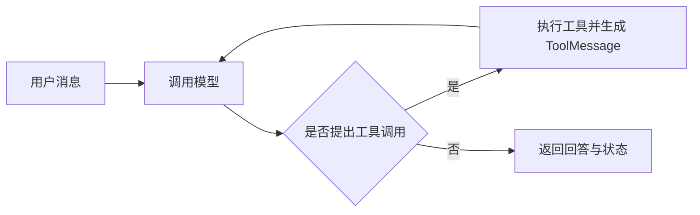

# 07-智能体

Agent 围绕任务目标组织模型与工具的多轮调用。本章介绍智能体的创建、工具循环、结构化输出、错误处理与流式响应。

> 适用版本：LangChain 1.2.12、LangGraph 1.1.2。

## 1. Agent 与单次模型调用

Agent 以模型为决策核心，围绕用户目标选择工具、执行动作、观察结果并决定是否继续。模型、工具、规划、记忆和行动是理解能力的角度，不要求每个应用都有一个独立的长期记忆或规划模块。

| 方式 | 谁组织流程 | 适合场景 |
| --- | --- | --- |
| `model.invoke()` | 应用负责下一步 | 单次问答、提取、分类 |
| `model.bind_tools()` | 应用解析调用并执行工具 | 简单、明确的工具流程 |
| `create_agent()` | Agent 运行时组织模型与工具循环 | 需要动态选择步骤的任务 |
| 自定义 LangGraph | 开发者显式设计图 | 固定流程、条件分支与智能决策的复杂组合 |

1.x 常用入口为 `from langchain.agents import create_agent`，底层返回编译后的 LangGraph 状态图。旧资料的 AgentExecutor、多个专用 Agent 工厂不应直接套进当前示例；新接口也不意味着所有旧函数在所有包中都被删除。

## 2. 创建与调用

### 2.1 模型字符串或模型对象

可以传支持识别的 `provider:model` 字符串，也可传已初始化的模型对象。需要自定义地址、参数或复用客户端时，模型对象更明确。

```python
import os
from dotenv import load_dotenv
from langchain.chat_models import init_chat_model
from langchain.agents import create_agent
from langchain.tools import tool

load_dotenv()
model = init_chat_model(
    model=os.environ["DEEPSEEK_MODEL"],
    model_provider="deepseek",
)

@tool
def multiply(a: float, b: float) -> float:
    """计算两个数的乘积。需要精确乘法时使用。"""
    return a * b

agent = create_agent(
    model=model,
    tools=[multiply],
    system_prompt="你是学习助手，乘法运算使用 multiply 工具。",
    name="study_assistant",
)
result = agent.invoke({
    "messages": [{"role": "user", "content": "计算 12.5 乘以 8。"}]
})
print(result["messages"][-1].content)
```

创建参数中 `model` 指定模型，`tools` 注册工具，`system_prompt` 定义系统规则，`name` 标识 Agent；后续还会用 `middleware`、`response_format`、`checkpointer`、`store`、`context_schema`。

### 2.2 输入输出要点

`agent.invoke()` 常用输入是包含 `messages` 的状态字典；返回状态字典，其中 `messages` 包含运行产生的模型消息和工具结果。不要写成 `result.content`。如果启用了结构化输出，应读取 `result["structured_response"]`，不能一律把最后一条消息视为自然语言答案。

工具可为空，但是否符合业务目标取决于任务；对象名叫 Agent 不代表自动获得搜索、记忆或操作系统能力。

## 3. 工具循环



普通工具 Agent 中，当模型不再提出工具调用时，一般结束循环；结构化输出工具、中断或自定义中间件可以改变结束路径。

任务“找热门耳机并查库存”包含两个依赖步骤：先搜索产品，观察结果，再查询选中型号的库存。模型根据结果决定下一步，运行时负责执行与传回消息。这种“决策—行动—观察”循环常用 ReAct 思路解释，但不要求向用户展示模型内部推理。

### 3.1 静态工具与现成集成

`tools=[...]` 可以传入自定义工具与集成工具。使用 `TavilySearch` 接入联网搜索时，需要安装 `langchain-tavily` 并配置 `TAVILY_API_KEY`。搜索结果是外部资料，不保证权威或最新；是否接入由任务需求决定。

动态工具选择见中间件章节。工具过多或描述重叠时，模型更难准确选择；应依据任务需要组织工具集合，并通过评测确定合适的范围。

### 3.2 重试与调用边界

工具返回“暂无结果”等业务反馈时，模型可能再次尝试；这不等于程序层的可靠重试策略。应明确失败终止条件，并配合模型/工具调用限制、超时与异常处理。

```python
result = agent.invoke(
    {"messages": [{"role": "user", "content": "计算 15 乘以 6。"}]},
    config={"recursion_limit": 20},
)
```

`recursion_limit` 限制图执行步骤，不精确等于工具调用次数；一个循环中可能有多个节点或多个工具。需要精确控制时使用第 8 章的调用限制中间件。运行时仍有图执行步数的保护机制。

### 3.3 常见问题

| 问题 | 检查方向 |
| --- | --- |
| 没有调用工具 | 模型是否支持；问题是否需要；描述是否清楚 |
| 选错工具 | 工具功能是否重叠；参数含义是否明确 |
| 反复调用 | 失败结果是否可理解；是否缺少退出规则；是否每次都强制调用 |
| 输出看似成功但实际没做 | 查看工具是否真正执行及结果，不能只信模型文本 |
| 过程不可见 | 用 LangSmith 或流式 updates 观察 |

## 4. 名称与系统提示词

`name` 用于消息来源区分、流式归因、Trace 可读性和组件管理。多 Agent 系统中名称尤其有用，但它不替代权限、租户或用户身份。

系统提示词应明确角色、工具何时使用、输出要求和失败时如何回答。例如“找不到用户时说明未找到，不反复查询同一信息”。提示词可以改善决策，但不能替代程序中的次数上限与权限控制。

静态规则放 `system_prompt`；按运行上下文动态生成规则可用 `dynamic_prompt` 中间件。普通 `create_agent` 不需要照搬旧版 Agent 的 scratchpad 提示词模板。

## 5. Agent 结构化输出

### 5.1 与模型结构化输出的区别

模型的 `with_structured_output()` 包装一次调用的解析结果；Agent 的 `response_format` 允许先执行多轮工具任务，再把最终结构化数据写入状态的 `structured_response`。

| `response_format` | 机制 | 使用前提 |
| --- | --- | --- |
| `ProviderStrategy(Schema)` | 提供商原生结构化输出 | 实际模型与 API 支持 |
| `ToolStrategy(Schema)` | 用结构化工具调用承载结果 | 模型支持工具调用 |
| 直接传 `Schema` 类型 | 框架按能力选择策略 | 能力识别需要与平台一致 |
| `None` | 不显式要求结构化结果 | 普通消息交互 |

`create_agent(response_format=Schema)` 支持直接传入 Schema，框架据模型能力选择策略。需要明确指定行为时，可以显式使用 `ProviderStrategy` 或 `ToolStrategy`。

### 5.2 Pydantic 示例

```python
from pydantic import BaseModel, Field
from langchain.agents import create_agent
from langchain.agents.structured_output import ToolStrategy

class CalculationResult(BaseModel):
    expression: str = Field(description="计算的表达式")
    value: float = Field(description="工具计算得到的结果")

structured_agent = create_agent(
    model=model,
    tools=[multiply],
    system_prompt="先使用乘法工具获得结果，再返回最终结构化答案。",
    response_format=ToolStrategy(CalculationResult),
)
state = structured_agent.invoke({
    "messages": [{"role": "user", "content": "计算 12.5 乘以 8"}]
})
print(state["structured_response"].value)
```

沿用第 2 节的 model、multiply。ToolStrategy 的“结果工具”用于传递数据并触发解析，与真实的乘法业务工具职责不同。

### 5.3 Schema 与返回类型

Agent 支持 Pydantic、TypedDict、JSON Schema 和 dataclass；Pydantic 通常返回对应实例，TypedDict/JSON Schema 返回字典，dataclass 路径可返回数据类实例。具体解析与校验由 Agent 策略实现，应结合所选策略确认返回类型和错误处理行为。

`ToolStrategy(Union[TypeA, TypeB])` 允许按输入选一种最终结果结构，通常期望一份结果；不表示一次返回所有 Schema 的对象。

`tool_message_content` 自定义成功输出后写入历史的确认文字，不改变 `structured_response` 的实际数据，也不决定最终 UI 应展示哪些内容。

## 6. 结构化输出的错误处理

常见错误是 `MultipleStructuredOutputsError`（应返回一个结果却给出多个）和 `StructuredOutputValidationError`（数据不符合结构）。

| `handle_errors` | 行为 |
| --- | --- |
| `True` | 反馈结构化输出错误，允许模型修正 |
| `False` | 不处理该错误，向上抛出 |
| 字符串 | 用固定错误提示反馈 |
| 异常类型 / 异常类型元组 | 仅处理指定错误 |
| 函数 | 根据异常返回反馈文字，或继续抛出 |

它针对结构化输出失败，不是“所有网络和工具异常总开关”。允许重试也不能保证最终成功，仍会受图步数、调用预算和模型能力限制。

## 7. 流式输出

| 模式 | 输出内容 | 适合用途 |
| --- | --- | --- |
| `values` | 每步之后的完整状态 | 查看状态演进 |
| `updates` | 节点产生的状态增量 | 观察模型、工具等步骤 |
| `messages` | 消息块及来源元数据 | 展示逐步生成的回答 |
| `custom` | 通过 stream writer 发出的业务数据 | 处理进度、业务事件 |
| `tasks` | 任务开始、结束、结果或错误事件 | 生命周期诊断 |
| `checkpoints` | 检查点相关事件 | 恢复与持久化诊断 |
| `debug` | 较完整的调试事件 | 开发排错 |

显式指定需要的模式，不依赖不同版本或对象的默认值。检查点相关输出需配合实际持久化配置；选择 `values` 或 `checkpoints` 本身不会创建永久存储。

```python
for mode, event in agent.stream(
    {"messages": [{"role": "user", "content": "计算 8 乘以 9"}]},
    stream_mode=["updates", "messages"],
):
    if mode == "updates":
        print("步骤更新：", event)
    elif mode == "messages":
        chunk, metadata = event
        for block in chunk.content_blocks:
            if block["type"] == "text":
                print(block["text"], end="", flush=True)
```

单模式和多模式的事件包装不同，多模式常见形式是 `(mode, event)`，不是遍历普通字典。这里使用 LangChain 1.2.12 的流式接口；升级版本时需确认事件格式。流式提高可见性，不保证降低总推理耗时。

## 8. 多功能助手案例

多功能助手可以组合天气查询、数学计算、时间与日期、汇率换算、信息搜索等能力。实现流程为：初始化模型 → 为各能力定义工具 → 用系统提示词说明选择与失败规则 → 主程序接收用户输入、执行并展示结果。

复现时先分开验证每个工具，再测试需要组合能力的问题。天气与汇率若来自模拟字典，应显式标为模拟；计算功能应限定表达式能力，不把任意用户文本直接交给 `eval`。多轮历史和跨会话记忆还需要第 9 章的配置。

## 9. 本章要点

- Agent 自动组织循环，但工具能力、状态、记忆和限制都要明确配置。
- 观察完整 messages 能理解执行过程；业务程序读取最终结构化结果时用 `structured_response`。
- 明确区分模型重试、工具重试、结构化纠错与图步骤上限。

### 思考题

1. 为什么一次 `agent.invoke()` 会触发多次计费？
2. Schema 直接传入是否受支持？
3. `messages` 与 `updates` 有什么区别？

## 10. 参考资料

- [Agents](https://docs.langchain.com/oss/python/langchain/agents)
- [Structured output](https://docs.langchain.com/oss/python/langchain/structured-output)
- [Streaming](https://docs.langchain.com/oss/python/langchain/streaming)
