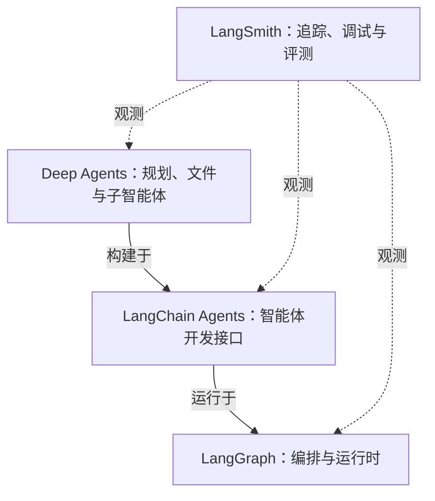

# Chapter 01｜LangChain 通识

> 根据项目中的 9 张课程截图整理，合并重复内容，重点梳理概念、组件关系与选型思路。截图中的生态介绍以「截至 2025 年 11 月」为背景；文末另列官方文档核对后的概念补充。整理日期：2026-10-20。

## 1. LangChain 生态概览

“LangChain”在学习资料中有两种含义：既可以指 **LangChain 开发框架本身**，也可以泛指围绕智能体开发形成的 **LangChain 技术生态**。

这套生态覆盖从技术验证、应用构建到运行监控与质量评估的过程。截图重点介绍四个核心组成部分：

| 组成部分 | 核心定位 | 主要解决的问题 | 关键词 |
| --- | --- | --- | --- |
| **LangChain** | 模型、工具与智能体开发框架 | 如何接入模型、组合能力并快速构建应用？ | 统一接口、模块化、集成 |
| **LangGraph** | 有状态工作流的编排与运行时 | 多个步骤如何流转，如何维护执行状态？ | 节点、边、状态、分支、循环 |
| **Deep Agents** | 面向复杂任务的智能体执行框架（Agent Harness） | 如何让智能体规划任务、管理文件并委派子任务？ | 规划、文件系统、子智能体、记忆 |
| **LangSmith** | 调用追踪、调试与评测平台 | 智能体运行过程是否正常，结果质量如何？ | 全链路追踪、调试、评测、协作 |

截图使用了 `Deep Agent` 和 `Deep Agents` 两种写法，本笔记统一使用官方项目名称 **Deep Agents**。

## 2. LangChain：智能体开发的基础能力

LangChain 为开发者提供模型调用、工具与中间件集成、智能体构建等能力，帮助快速搭建基于大语言模型（LLM）的应用。

### 2.1 统一模型接口

不同模型服务或运行平台，例如 OpenAI、Anthropic、Ollama，具有不同的接口形式。LangChain 通过统一的模型抽象，减少应用直接适配不同接口的工作量。

**学习重点：把注意力更多放在应用逻辑上，同时保留对具体模型能力和配置差异的理解。**

### 2.2 模块化设计

截图提到的主要组件如下。表中的解释用于帮助理解各组件的职责。

| 组件 | 含义 | 作用 |
| --- | --- | --- |
| Model / LLM | 模型 | 理解输入、生成回复，支持智能体决策 |
| Message | 消息 | 组织用户、模型与工具之间交换的信息 |
| Tool | 工具 | 将搜索、订票、数据库查询等外部能力提供给智能体 |
| Agent | 智能体 | 围绕目标组织模型与工具的调用 |
| Middleware | 中间件 | 在运行过程中加入自定义处理逻辑 |

这些组件可以组合和扩展，不必为每种应用从头实现所有基础功能。

### 2.3 丰富的集成生态

LangChain 提供模型、数据源、API 和中间件等集成，方便将外部能力接入应用。截图中的典型例子包括搜索、订票和数据库查询。

**适用思路：** 当目标是快速构建智能体，或主要需求是模型接入、工具调用与常规智能体逻辑时，可以从 LangChain 入手。

## 3. LangGraph：复杂工作流的编排与运行时

当任务扩展为多步骤、带分支或循环、需要共享上下文的工作流时，就需要更明确地管理执行过程。

LangGraph 的核心思想是：**将工作流表示为一张有向图，通过节点、边和状态描述任务如何执行。**

### 3.1 三个核心概念

| 概念 | 含义 | 理解方式 |
| --- | --- | --- |
| **Node（节点）** | 执行某项功能或计算的单元 | 这一步做什么 |
| **Edge（边）** | 节点之间的执行路径；条件边用于根据条件选择后续路径 | 下一步去哪里 |
| **State（状态）** | 工作流各步骤共享和更新的上下文 | 当前已知什么、完成了什么 |

状态可以承载任务信息和中间结果；需要在中断或后续调用中恢复时，还要配置相应的持久化机制。

### 3.2 能解决什么问题

- **多步骤执行：** 将任务拆成明确的处理节点。
- **条件分支：** 根据当前状态或执行结果选择后续路径。
- **循环与反馈：** 根据检查结果返回前面的步骤继续处理。
- **状态维护：** 在不同步骤之间传递并更新任务上下文。
- **多智能体协作：** 编排不同智能体之间的分工和信息交换。

图结构让流程更明确，也便于控制和观察执行过程。

### 3.3 与 LangChain 的职责区别

可以用截图中的两个问题来记忆：

- **LangChain：有什么能力？** 关注模型、工具、消息等抽象及集成。
- **LangGraph：流程怎么运行？** 关注执行路径、循环、分支和状态维护。

**适用思路：** 当应用需要精细控制工作流，或者需要组合固定流程与智能体决策时，可以直接使用 LangGraph。

## 4. Deep Agents：面向复杂任务的智能体执行框架

Deep Agents 的定位是 **Agent Harness（智能体执行框架）**：在 LangChain 和 LangGraph 的基础上，提供规划、文件管理、子智能体等较完整的能力组合，减少开发者自行搭建复杂智能体控制逻辑的工作。

### 4.1 核心能力

| 能力 | 主要作用 |
| --- | --- |
| **显式规划** | 生成多步骤任务计划，并在执行中调整计划 |
| **虚拟文件系统** | 保存、组织和访问中间结果与知识材料 |
| **子智能体** | 将任务拆分并委派给不同智能体协作完成 |
| **长期记忆支持** | 配合存储机制，让信息可以在后续对话中复用 |
| **可扩展中间件** | 加入安全审计、性能监控或自定义业务逻辑 |

其中，“支持长期记忆”需要结合实际存储配置理解，不能直接等同于所有信息都会自动跨会话永久保存。

### 4.2 适用思路

如果任务需要规划多个步骤、维护较多中间材料，或者委派给多个专业子智能体处理，可以考虑 Deep Agents 提供的现成能力。

例如，**调研并撰写报告**可以拆成制定计划、搜集材料、分工分析、保存中间结果、汇总成文等步骤。这是对截图能力的应用举例。

## 5. LangSmith：让运行过程可追踪、结果可评估

智能体系统复杂后，仅靠日志和 `print` 不容易看清完整的执行过程。LangSmith 用于追踪、记录和分析调用链路，帮助开发者理解系统行为并评估质量。

### 5.1 四个核心目标

| 目标 | 具体内容 |
| --- | --- |
| **全链路追踪** | 查看模型调用、提示词输入、结果输出和工具使用等过程 |
| **调试与优化** | 定位异常行为，分析性能瓶颈 |
| **评测与质量控制** | 通过人工和自动化评测，衡量智能体表现 |
| **团队协作** | 共享测试集与调用记录，方便共同分析问题 |

LangSmith 贯穿开发与运行过程，可以与上述框架配合使用。它的作用是帮助回答：**系统执行了哪些步骤、哪里出了问题、调整之后效果是否更好。**

## 6. 四者如何协作

### 6.1 按职责理解

截图将 LangChain 视为基础能力层，LangGraph 视为运行编排层，Deep Agents 视为更高层的智能体能力组合，LangSmith 则提供监控与评估。

这是一种帮助理解职责的划分。实际开发中，它们可以协同使用，不必把选择理解为只能四选一。

### 6.2 按实现关系理解

下面的图表示高层智能体实现与底层运行时之间的关系，补充说明截图中的概念分层：

**LangGraph 也可以独立使用。** “LangChain 提供基础能力”描述的是开发职责，不代表 LangGraph 在代码依赖上必须建立在 LangChain 之上。

### 6.3 需求与选型对照

| 当前主要需求 | 可以优先考虑 | 原因 |
| --- | --- | --- |
| 接入模型、组合工具、快速构建智能体 | LangChain | 提供统一抽象与常用智能体开发能力 |
| 精细控制分支、循环、状态和复杂工作流 | LangGraph | 可以显式定义和控制执行过程 |
| 使用现成的规划、文件管理与子智能体能力 | Deep Agents | 提供面向复杂任务的能力组合 |
| 追踪执行、排查异常、比较输出质量 | LangSmith | 提供观测与评测支持，可与上述方案组合 |

截图给出的学习路径是：先理解 LangChain 的基础能力，再学习 LangGraph 的编排思想，随后认识 Deep Agents 的高级能力，并用 LangSmith 观察和评估运行效果。**这是学习路径，实际项目可以按需求直接选择合适的入口。**

## 7. 复习速记

- **LangChain：连接并组合能力。**
- **LangGraph：控制执行流程和状态。**
- **Deep Agents：提供规划、文件和任务委派能力。**
- **LangSmith：追踪过程，评估效果。**

学习完本章，应能说明：模型与工具的作用是什么；节点、边和状态如何描述工作流；复杂任务为什么需要规划与子智能体；为什么运行成功之后仍需要追踪与评测。

## 8. 资料链接与概念补充

### 8.1 截图提供的资料入口

| 资料 | 链接 |
| --- | --- |
| LangChain 官网 | [langchain.com](https://www.langchain.com/) |
| GitHub 组织 | [langchain-ai](https://github.com/langchain-ai) |
| 截图中的中文文档入口 | [LangChain 中文概览](https://docs.langchain.org.cn/oss/python/langchain/overview) |
| 官方英文文档 | [LangChain Overview](https://docs.langchain.com/oss/python/langchain/overview) |
| Python API 参考 | [LangChain Python Reference](https://reference.langchain.com/python/langchain/) |

### 8.2 官方文档核对补充（2026-10-20）

为避免将课程示意图直接理解为代码依赖图，本笔记对以下概念作了补充：

1. **实现关系：** LangChain 的智能体构建在 LangGraph 运行时之上；Deep Agents 在 LangChain 智能体基础上提供更完整的能力组合。
2. **记忆与持久化：** 工作流中的 State、同一线程的检查点恢复，以及跨会话长期记忆，是相关但不同的概念；长期保存与复用需要相应的存储支持。
3. **选型方式：** 三个开发框架服务于不同抽象层次，可以组合，也可以按需要直接使用其中合适的一层。

核对参考：[Deep Agents Overview](https://docs.langchain.com/oss/python/deepagents/overview)、[Deep Agents Python 参考](https://docs.langchain.com/oss/python/reference/deepagents-python)、[LangGraph Overview](https://docs.langchain.com/oss/javascript/langgraph/overview)。

## 附录：原始图片索引

以下链接指向 `附件/chapter01/` 中的原图，便于回看课程内容。

| 图片 | 主要内容 |
| --- | --- |
| [212021](<附件/chapter01/屏幕截图 2026-10-19 212021.png>) | 官网、GitHub 与文档入口 |
| [212216](<附件/chapter01/屏幕截图 2026-10-19 212216.png>) | LangChain 智能体生态及四个核心组成部分 |
| [212331](<附件/chapter01/屏幕截图 2026-10-19 212331.png>) | LangChain 定位与核心价值 |
| [212406](<附件/chapter01/屏幕截图 2026-10-19 212406.png>) | LangGraph 的节点、边和状态 |
| [212452](<附件/chapter01/屏幕截图 2026-10-19 212452.png>) | LangChain 与 LangGraph 的职责对比 |
| [212531](<附件/chapter01/屏幕截图 2026-10-19 212531.png>) | Deep Agents 定位与核心能力 |
| [212614](<附件/chapter01/屏幕截图 2026-10-19 212614.png>) | 三个开发框架的协作关系 |
| [212643](<附件/chapter01/屏幕截图 2026-10-19 212643.png>) | LangSmith 的定位 |
| [212703](<附件/chapter01/屏幕截图 2026-10-19 212703.png>) | LangSmith 的四个核心目标 |
